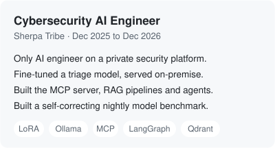
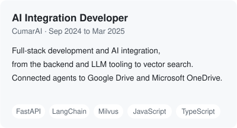

<h1 align="center">Colas Gelin</h1>

<strong>AI engineer. I build LLM applications and measure whether they work.</strong>

  
  
  

  <a href="mailto:cgelin.pro@gmail.com"><strong>Email</strong></a> &nbsp;·&nbsp;
  <a href="https://www.linkedin.com/in/colas-gelin-8931b3189/"><strong>LinkedIn</strong></a> &nbsp;·&nbsp;
  <a href="https://www.colasgel.in"><strong>Portfolio</strong></a>

---

## ⭐ Highlights

- 🛡️ **Only AI engineer** on a private cybersecurity platform at Sherpa Tribe
- 🎓 **Self-taught through 42 School**: level 19.70 of 21, graduating May 2027
- 🏆 **1st place**, NASA Space Apps Challenge Málaga 2025
- 🏆 **1st place**, Lanoria Hackathon, Málaga
- 🤖 **I build AI across the stack**: fine-tuned models, RAG pipelines, agents and full-stack apps, with benchmarks to measure what works

## 💼 Experience

  
  

## 🎓 School

<picture>
  <source media="(max-width: 1240px)" srcset="assets/42-school-narrow.svg?v=4">
  
</picture>

Fields I covered:

- **Neural networks:** [Multilayer-Perceptron](https://github.com/ColasGelin/Multilayer-Perceptron), a network from scratch with no ML framework to diagnose maligne breast tumors
- **Reinforcement learning:** [Learn2Slither](https://github.com/ColasGelin/Learn2Slither), a Self learning RL Snake agent
- **Brain-computer interfaces:** [Total-Perspective-Vortex](https://github.com/ColasGelin/Total-Perspective-Vortex), an ML project using brain signals to predict patient's movement
- **Infrastructure:** [Inception-of-Things](https://github.com/ColasGelin/Inception-of-Things), Kubernetes and GitOps with Argo CD and GitLab
- **Systems programming:** [Minishell](https://github.com/ColasGelin/Minishell-42project), a bash clone in C, built entirely from scratch

## 🚀 Public projects

**[jobcopilot](https://github.com/ColasGelin/jobcopilot)**: collects job offers, scores them with Claude, tailors my CV and drafts answers. A code guard catches invented facts, and it never submits an application. 
`FastAPI` `htmx` `Docker` `Playwright` `440+ tests`

**[Supermarket-Queue-Manager](https://github.com/ColasGelin/Supermarket-Queue-Manager)**: self-hosted queue monitor. An agent suggests actions and a human decides. 
`YOLOv8` `LangGraph` `Ollama` `Grafana`

**[Hackathon-LaNoria](https://github.com/ColasGelin/Hackathon-LaNoria)** 🏆: phone camera app that describes surroundings aloud to blind users and warns of danger. 
`Next.js` `Gemini`

**[Re-fresh.earth](https://github.com/ColasGelin/Re-fresh.earth)** 🏆: 3D heat map of Málaga from Landsat data, with green zone simulation. 
`Next.js` `Three.js`

## 🧰 Main tools

`Python` `TypeScript` `FastAPI` `LangChain` `LangGraph` `Qdrant` `Milvus` `Ollama` `Docker` `Kubernetes` `Next.js`

## 🌍 Languages

French (native), Spanish (C1), English (C1)
